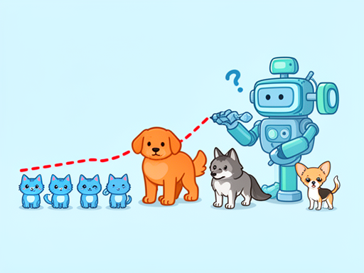
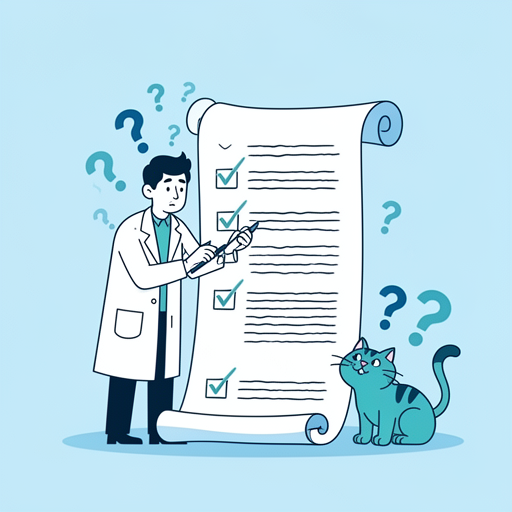
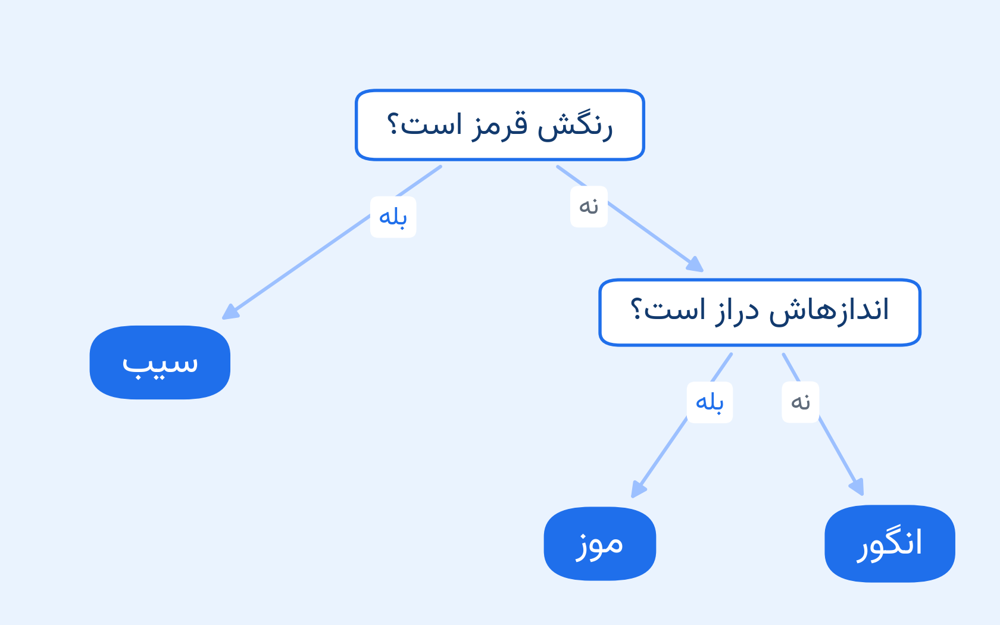
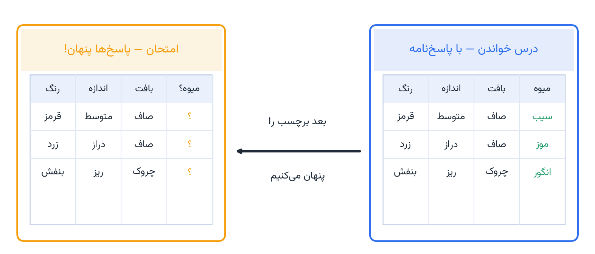
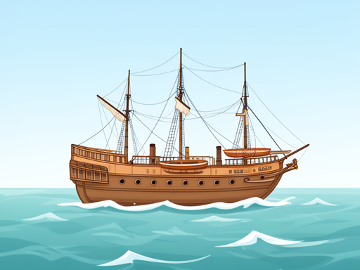
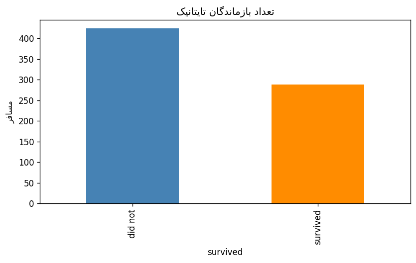
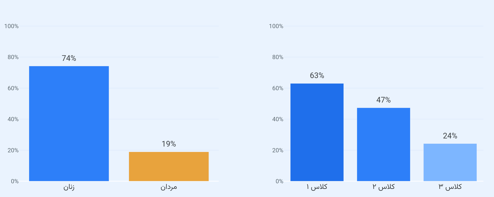
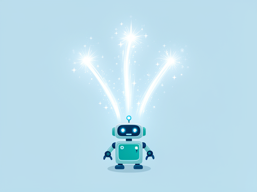
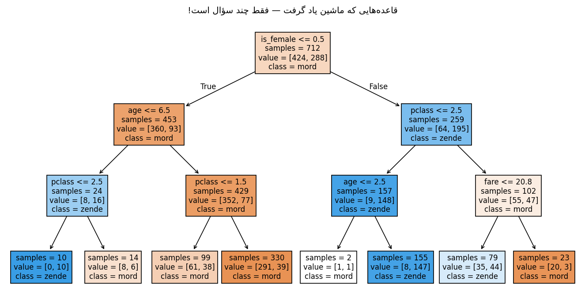

<!-- _class: lead -->
<!-- _paginate: false -->

# یادگیری ماشین چیست؟

## روز اول — تو یک هوش مصنوعی می‌سازی

**بخش ۱ · جلسهٔ ۱**

*تا پایان امروز، تو یک مدل یادگیری ماشین آموزش می‌دهی.*


<!--
INSTRUCTOR — Session 1 of 32. 60 min teaching + 60 min problem-solving.
BEFORE CLASS: test PART 0 demo cells; notebook runs top-to-bottom; assets exist.
TIMING: hook 0-5, big question 5-10, fruit game 10-20, supervised 20-30, Titanic 30-40, magic lines 40-50, quiz 50-55, handout 55-60.
-->

---
<!-- _class: hook -->

# نمایش ویژهٔ هوش مصنوعی

# یک دمو. یک خطِ قرمز. یک سؤال.

*خوب نگاه کن.*

<!--
[0:00] THE HOOK — run the single PART 0 demo cell, showmanship, dim lights.
SAY: "By the end of today, YOU will build what you are about to see."
FALLBACK: narrate from notes, never skip the hook.
-->

---
<!-- _class: hook -->

# بازیِ حیوانات

ماشین فقط این را می‌بیند: **۸ حیوان با برچسب**

هر حیوان = دو عدد (وزن، طول گوش) + یک پاسخ

*هیچ قانونی به آن داده نشده. هیچ.*

<!--
[RUN: PART 0 demo cell — prints "stage 1 - the table"] The 8-row table is ALL the machine sees.
SAY: "8 animals. Two numbers each, plus the answer. Nobody wrote a single rule."
EXPECT: "so what? it's just a table" — perfect, let them underestimate it.
-->

---
<!-- _class: hook -->

# خطِ ماشین

از دلِ همان ۸ سطر، ماشین **خودش** یک خط کشید.

پشتِ خط: گربه‌ها. جلوی خط: سگ‌ها.

**«این خط را چه کسی کشید؟!»**



<!--
[RUN: PART 0 demo cell — prints "stage 3 - the machine's line"] The scatter: the machine's own red dashed line.
(stage 2 was the silent .fit() — one invisible line of code.)
SAY: "No human drew this line. The machine found it hiding in those 8 rows."
EXPECT: "where did the line come from?!" — do NOT explain yet.
-->

---
<!-- _class: hook -->

# حالا امتحانش کنیم

حیواناتی که ماشین **هرگز ندیده:**

گرگ ← سگ. گربهٔ همسایه ← گربه. **درست!**

توله‌سگ ← گربه؟! فیل ← سگ؟!

**کل رازش فقط یک سؤال بود: «وزن ⁦≤ ۱۴⁩ کیلوگرم؟»**

<!--
[RUN: PART 0 demo cell — prints "stage 4 - exam with unseen animals"] Verdicts on unseen animals.
Let the puppy/elephant errors land as LAUGHS, then the cell prints the reveal: one question, weight ≤ 14 kg.
SAY: "It learned ONE question from 8 rows — and it still gets the puppy wrong. Learning is a guess."
SEED: "How does the machine pick that ONE question? Session 3 answers it — but first, Session 2."
-->

---

# سؤال بزرگ

چطور یک کامپیوتر را باهوش کنیم؟

<!--
[5:00] Segment A: rules vs learning. DRAW both boxes on the board — they stay ALL session.
Next slide's interaction is the core; don't lecture through it.
-->

---

# راه اول — روش قدیمی: نوشتن قاعده‌ها

`داده + قاعده‌ها ← پاسخ`

انسان هر قاعده را با دست می‌نویسد.

«اگر سبیل داشت و خرخر می‌کرد، پس گربه است»

<!--
Board box 1: data + RULES = answers.
SAY: "For 50 years, smart people wrote thousands of IF-THEN rules. Worked... until it didn't."
Transition: "Let's try it ourselves. Cats. Easy, right?"
-->

---

# مشکل نوشتن قاعده

حالا نوبت شماست: قاعده‌هایی بنویسید که گربه را بشناسد.

گربهٔ بدون مو؟ گربه در لباس؟ حیوان کوچک؟!

هیچ‌کس نمی‌تواند به‌اندازهٔ کافی قاعده بنویسد!



<!--
INTERACTION (3-4 min): students propose cat rules, you counter each.
"has fur" = hairless cat; "whiskers" = walrus; "small cute" = corgi puppy.
Concede: "This is why we don't write rules. We show examples."
-->

---

# راه ۲ — یادگیری ماشین

`داده + پاسخ‌ها ← قاعده‌ها`

ماشین قاعده را کشف می‌کند.

**همان خطِ قرمزِ اولِ جلسه.**

<!--
Board box 2 under box 1: data + answers = RULES — point silently.
REVEAL: the 8 animals WERE the examples; the red line WAS the rule.
CHECK: "What does the machine get, what does it produce?"
Return to the red line 5+ times today.
-->

---

<!-- _class: definition -->

# هوش مصنوعی در برابر یادگیری ماشین

**هوش مصنوعی (AI)** = آرزوی بزرگ: ماشینِ هوشمند

**یادگیری ماشین (ML)** = راهِ رسیدن به آن آرزو: یادگیری از داده

<!--
[~7:00] 60 seconds max. [MISCONCEPTION] AI and ML are NOT synonyms.
Analogy: AI = becoming a doctor (dream); ML = medical school (how).
-->

---

# بازی میوه 

| رنگ | اندازه | بافت | ← میوه |
|------|-------|---------|--------|
| قرمز | متوسط | صاف | ؟ |
| زرد | دراز | صاف | ؟ |
| بنفش | ریز | چروک | ؟ |

*ستون پاسخ را بپوشان. از سرنخ‌ها میوه را حدس بزن.*

<!--
[10:00] Segment B: fruit game. Cover the fruit column, read clues, class shouts labels. 2 min, high energy.
RUN cell A1: this table IS a DataFrame.
Next: which clue is most useful — vote.
-->

---
<!-- _class: definition -->

# واژگان جدید 

**ویژگی (Feature)** = سرنخ *(یک ستون)*

**برچسب (Label)** = پاسخ *(ستونی که پیش‌بینی می‌کنیم)*

**نمونه (Example)** = یک سطر = سرنخ‌ها + پاسخ

<!--
WRITE on board (never erased): feature, label, example.
Hooks (from the analogy map, nothing ad-hoc): feature = a clue; label = the answer; example = one solved exercise.
[MISCONCEPTION] the label is hidden at quiz time, not read by the model.
CHECK: "3 Titanic features + the label?"
-->

---

# کدام ویژگی مهم است؟

رنگ؟ اندازه؟ بافت؟

کدام سرنخ برای حدس زدن میوه بهتر جواب می‌دهد؟

*(رأی بدهید. مناقشه کنید. جواب غلطی وجود ندارد — هنوز.)*

<!--
INTERACTION: hands-up vote per feature, quick debate.
SAY: "You just did data science. Session 9 computes this as feature importance."
RUN cell A2 — students record their guess (revisited in Session 9).
-->

---

# سؤال‌های پشتِ سرِ هم

حدس‌هایتان را به یک زنجیره بگذارید:

اول رنگ را بپرس، بعد اندازه را.

*یک نقشهٔ تصمیم — با دست، بدون هیچ کدی.*

<!--
EXPERIENCE before code: the class chains its own guesses.
DRAW with them: "red? apple. not red, long? banana. else grapes."
The decision tree arrives INTUITIVELY. The NAME is withheld until Session 2.
-->

---
<!-- _class: wow -->

# نقشهٔ تصمیمِ میوه



همان حدس‌های خودتان — فقط مرتب شده.

<!--
SHOW the fruit decision map. TRACE one fruit together: purple, small, wrinkly -> grapes.
[HONESTY BEAT — do it!] The map MISJUDGES 2 of the 6 fruits in A1's own table:
the green medium apple (map says grapes) and the yellow medium banana (map says grapes).
Trace the green apple on purpose, hit the wrong room, and SAY: "Our hand-drawn rules
already fail on 2 fruits out of 6 — now imagine 8 million pictures. THIS is why
the machine learns the map FROM the data instead." (This seed becomes Session 2's hook.)
SAY: "A human drew this. Next session: the MACHINE draws its own map — by itself."
DO NOT say "decision tree" yet.
-->

---

# یادگیری نظارت‌شده (Supervised Learning)

یادگیری از نمونه‌هایی **که پاسخ دارند.**



<!--
[20:00] Segment C. LIVE MINI-GAME: 4 solved fruit examples, then a 5th with hidden label — class predicts.
The picture IS the concept: LEFT table = study with the answer key, RIGHT table = the new exam, answers hidden.
SAY: "You just did supervised learning. Personally."
RUN cell A3: study table vs quiz table — the code version of exactly this picture.
-->

---

# چرا «نظارت‌شده»؟

هیچ انسانی مدل را تماشا نمی‌کند!

یعنی **داده‌ها پاسخ دارند.**

*(تاریخ یک کلمهٔ عجیب انتخاب کرده. )*

<!--
[MISCONCEPTION] "supervised" does NOT mean a person watches the model — the data has answers.
Use the laugh, then CHECK: "Why 'supervised'?" — examples come with answers.
-->

---

# تایتانیک

۸۹۱ مسافر، ۸۹۱ سطر.



هر سطر، یک زندگی است؛ هر ستون، یک سرنخ.

اگر جای آن‌ها بودی، زنده می‌ماندی؟

<!--
[30:00] Segment D: Titanic as pictures. Students follow cells A4-A6.
NARRATE THE HISTORY while plotting — the story is the engine.
A4: 891 passengers in the raw file; the cell prints that only the 712 rows with
COMPLETE info teach the model. 10-second beat: "real data has holes — we keep the complete rows."
-->

---

# داده به‌صورت عکس 



*همیشه قبل از هر کاری، داده‌ات را ببین.*

<!--
[RUN cell A5] More died than survived — 424 vs 288 of the 712 complete rows.
RULE (course-wide): every dataset gets PLOTTED before MODELED.
-->

---
<!-- _class: wow -->

# بقا بر حسب جنسیت و کلاس 



حدود ۷۵٪ زنان زنده ماندند؛ اما فقط ۲۰٪ از مردان.

<!--
[RUN cell A6] THE PUNCHLINE PLOTS. Let students read the bars first.
ASK: "Which feature matters for survival?" — gender, then class.
SAY: "A rich woman in 1912 had close to a survival ticket."
-->

---
<!-- _class: hook -->

# لحظهٔ جادویی

در ۳ خط، یک هوش مصنوعی بساز



*با من تایپ کن. واقعاً — نت‌بوک را باز کن و تایپ کن.*

<!--
[40:00] Segment E — emotional peak. Students TYPE ALONG cells A7-A9 (not just watch).
A7: X and y separated — "line 0 is setup, not magic."
CEREMONY before fit(): "On three, everyone say LEARN."
-->

---
<!-- _class: codespot wow -->

# سه خط جادویی 

```python
model = DecisionTreeClassifier(max_depth=3) # 1. pick a student ← this IS the model
model.fit(X, y) # 2. let it study
model.predict(new_passengers) # 3. ask it questions
```

**بساز ← یاد بده ← پیش‌بینی کن**

*این ریتم، کل یادگیری ماشین است. نه فقط امروز.*

<!--
[RUN cell A8, students typing] Write the 3 lines LARGE on the board.
create = pick a student; fit = let it study; predict = ask, label hidden.
SAY: "Every model you'll ever meet follows these three lines."
-->

---

# چه چیزی یاد گرفت؟



همان طور که می‌بینی فقط چند سؤال ساده است؛ حتی خودت هم می‌توانستی بکشیش.

<!--
[RUN cell A9] Predict for a volunteer: "Would Sara, 2nd class, age 13, survive?"
Tree picture: "Your fruit map from 15 minutes ago? Same shape — the machine drew its own."
Who chose the questions? The machine did — cliffhanger for Session 2.
-->

---
<!-- _class: dark -->

# یک حرف آخر

این مدل یک **مغز نیست.**

فقط الگویی از سؤال‌ها پیدا کرده که با بقا جور در می‌آید.

و همین، خودش شگفت‌انگیز است.

<!--
Slow, quiet, honest moment.
SAY: "A mirror of 712 examples. Good data, good mirror. Unfair data, unfair mirror."
Then snap energy back up for the quiz.
-->

---
<!-- _class: quiz -->


# امروز یاد گرفتی 

- قاعده ← پاسخ، یا پاسخ ← **قاعده**
- **ویژگی** (سرنخ) و **برچسب** (پاسخ)
- **یادگیری نظارت‌شده** = نمونه‌های همراه با پاسخ
- سه خط جادویی: **بساز ← یاد بده ← پیش‌بینی کن**

<!--
[50:00] CONSOLIDATION — cold call, friendly. One question per student:
get+produce? feature/label? 3 magic lines? why women survived?
If anyone stumbles on Q1-3, re-explain NOW.
-->

---

# تحویل امشب

اولین نت‌بوک یادگیری ماشین‌ات ← **مخزن گیت‌هاب تو**

«اگر آن روز سرِ تایتانیک بودم، زنده می‌ماندم؟» — مدلی که خودت ساختی جواب می‌دهد

<!--
[55:00] THE SHIP + handout. Explain the loop OUT LOUD:
4 problems tonight (20-30 min) = next session we solve them TOGETHER from YOUR attempts.
Judge: python judge/run.py s01_notebook.ipynb
-->

---
<!-- _class: handout -->

# تمرین‌های خانه (۴ تا)

1. **B1** کارآگاه ویژگی‌ها
2. **B2** دیتاست خودت را بساز
3. **B3** سه خط جادویی روی حیوانات خودت
4. **B4** پیش‌بینی‌گر بقا

<!--
One sentence of story per problem:
B1 dumb features under scrutiny; B2 invent your own dataset; B3 magic lines on YOUR data; B4 the 12-year-old boy verdict.
Deadline: before the problem-solving session. ~20-30 min total. First judge run is all-red — that's normal.
-->

---

<!-- _class: lead -->
<!-- _paginate: false -->

# جلسهٔ بعد

تمرین‌هایت را همان‌جا، با هم حل می‌کنیم.

حتی کدهای خراب را بیاور — آن‌ها سوختِ جلسهٔ بعدی است.


<!--
[60:00 — end on time] "Tonight your repo goes live. Show your family: I built an AI today."
CLIFFHANGER: "Who chose the tree's questions? Next time: you fix the machine's mistakes."
AFTER CLASS (48h): fill the retro note in the session README.
-->
