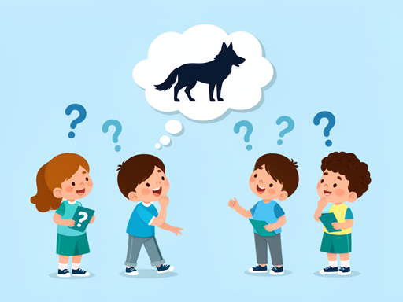
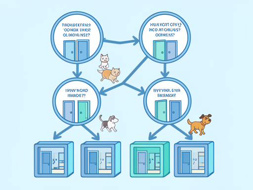
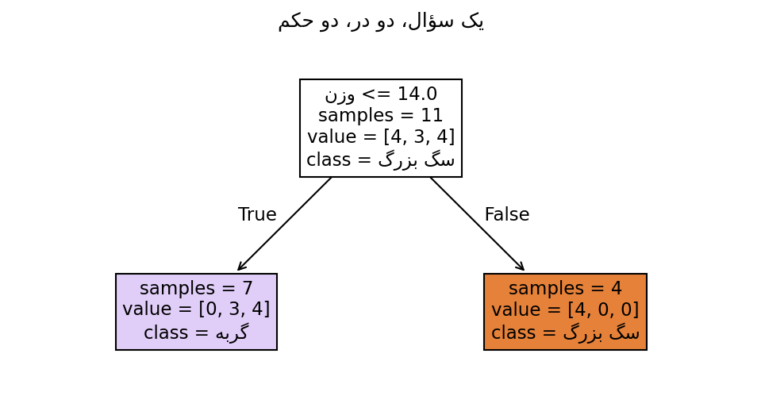
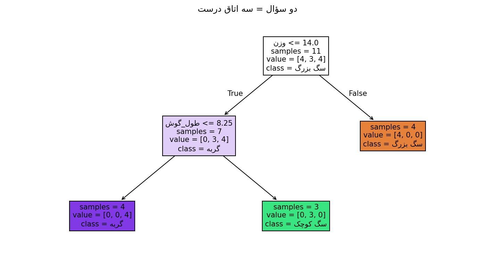
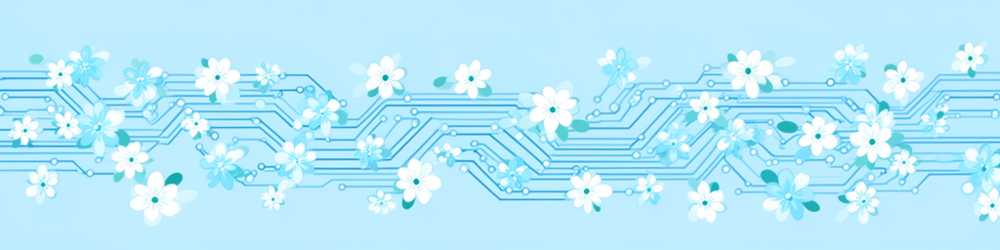

<!-- _class: lead -->
<!-- _paginate: false -->

# ماشینِ ۲۰ سؤالی

## روز دوم — تو یک درخت تصمیم می‌کشی

**بخش ۱ · جلسهٔ ۲**

*تا پایان امروز، تو یک درخت تصمیم با دست می‌کشی.*


<!--
INSTRUCTOR — Session 2 of 32. 60 min teaching + 60 min problem-solving.
BEFORE CLASS: PART 0 demo tested; animals_table.pdf printed per student; blank paper; judge 3/3.
TIMING: hook 0-5, anatomy 5-15, reading 15-25, depth 25-35, lab 35-50, quiz 50-55, handout 55-60.
-->

---
<!-- _class: hook -->

# بازیِ ۲۰ سؤالی

من به یک حیوان فکر می‌کنم.

فقط سؤالِ **بله/خیر** بپرسید.

*شمارنده بالا می‌رود...*



<!--
[0:00] HOOK beat 1 — human game, no notebook yet.
You think of a WOLF. Class asks yes/no only. Count questions on the board, aloud.
When they get it: do NOT clear the board — the path feeds slide 3.
Never skip.
-->

---
<!-- _class: hook -->

# شما همین الان یک درخت بودید

هر جواب یک **در** بود؛ هر در، یک راهِ تازه.

اسمِ این شکل: **درخت تصمیم** — بازیِ ماشینِ جلسهٔ ۱.

<!--
[~3:00] Redraw the game's path as a diagram: question circles, answer doors, verdict.
SAY: "Every answer was a door. You just walked a decision tree. Last session's red line? ONE question, ONE door."
EXPECT a student to make the red-line connection themselves.
-->

---
<!-- _class: hook -->

# حالا ماشین بازی کند

جلسهٔ قبل: یک سؤال ← توله‌سگ گربه شد!

امروز: **دو سؤال** اجازه دارد.

<!--
[RUN: PART 0 demo cell] Depth-1 vs depth-2, puppy verdict under each.
SAY: "One question got the puppy wrong. Watch what a second question does."
EXPECT: "It fixed it?!" Close: "You've played decision trees your whole life."
FALLBACK: narrate from slides 7 and 10.
-->

---
<!-- _class: definition -->

# کالبدشکافی درخت

**گره (Node)** = یک سؤال — چهارراهی با تابلو

**شاخه (Branch)** = درِ هر جواب (بله/خیر)

**برگ (Leaf)** = اتاقِ آخر — جای گفتنِ حکم



<!--
[5:00] NAME slide — experience already happened.
Point at the BOARD path: node = question, branch = door, leaf = verdict room.
[MISCONCEPTION] the tree cannot change questions mid-game — path is fixed.
CHECK: "Max leaves of a 2-question tree?" (4)
-->

---
<!-- _class: quiz -->

# فیل کدام در را می‌گذرد؟

`وزن ≥ ۱۴؟` ← بله

`گوش ≥ ۸.۲۵؟` ← بله

*حکم: سگ بزرگ!*

<!--
INTERACTION (2 min): class shouts the elephant's door at each node on the projected tree.
Trace: weight >= 14 yes, ears >= 8.25 yes, big-dog room.
SAY: "A leaf says ONE word for whatever reaches it — even a 3-ton elephant." 
-->

---

# ماشینِ جلسهٔ ۱ = یک سؤال



خطِ قرمزِ جلسهٔ ۱، به شکلِ درخت.

*یک سؤال، دو در، دو حکم.*

<!--
[RUN: cell A1] Depth-1 tree picture — same mechanic as last session's red line.
SAY: "The line and this picture are the SAME thing. Only the drawing changed."
Seals continuity: Session 1's model was a tree all along.
-->

---
<!-- _class: definition -->

# ریشه: اولین سؤال

ماشین `وزن ≥ ۱۴` را انتخاب کرد.

شما در بازی، اول چه پرسیدید؟

<!--
[15:00] Segment B. NAME: root = the first fork.
[RUN: cell A2] class reads both questions aloud for a wolf.
INTERACTION: their first questions from the hook — most asked weight too.
Plant: "the machine picked exactly 14. Why? Next session." 
-->

---
<!-- _class: wow -->

# دو سؤال، سه اتاق



گربه‌ها، سگ‌های بزرگ، سگ‌های کوچک — هر کدام اتاقِ خودشان.

<!--
[RUN: cell A2] THE punchline picture — real plot_tree output.
SAY: "One question split light from heavy. The second split cats from small dogs."
ASK before running: "Which room does the puppy reach now?" — let them say it.
-->

---
<!-- _class: quiz -->

# مسیر را بخوان: توله‌سگ

`وزن ≥ ۱۴؟` ← نه

`گوش ≥ ۸.۲۵؟` ← بله

*حکم: سگ کوچک — درست!*

<!--
[RUN: cell A3] visitors: wolf, puppy, elephant — students trace BEFORE the machine answers.
puppy: weight no, ears yes, small-dog room — correct.
SAY: "The second question — ears — is the cure for last session's mistake." 
-->

---
<!-- _class: definition -->

# پیچِ عمق (max_depth)

`max_depth` = حداکثر تعداد سؤال‌ها

عمق ۱: توله‌سگ گربه می‌شود — ۷۳٪ درست

عمق ۲: همه‌چیز درست — ۱۰۰٪

<!--
[25:00] Segment C. NAME: depth = longest question path.
[RUN: cell A4] depth 1 vs 2, accuracy 73% then 100%.
[MISCONCEPTION] more depth is not automatically smarter — WE turn the knob.
CHECK: "Leaves at depth 1 / 2 / 3?" (2/4/8)
-->

---
<!-- _class: codespot wow -->

# دستت را روی پیچ بگذار

```python
max_depth = 2   # عدد را عوض کن

model = DecisionTreeClassifier(max_depth=max_depth)
model.fit(X, y)
```

*کوچک‌ترین عمقِ بی‌نقص چند است؟*

<!--
[RUN: cell A5 — students change the number THEMSELVES]
RACE: first to find the smallest perfect depth (2) shouts it.
Then max_depth=10 — the tree becomes a jungle; let them laugh.
"More questions is not always better — WHY is a story for later." 
-->

---
<!-- _class: hook -->

# آزمایشگاه: درختِ خودت را بکش

۱۱ حیوان. سه اتاق. فقط سؤال‌های بله/خیر.

*کاغذ و مداد. هر درختی که کار کند، برنده است.*


<!--
[35:00] THE LAB — the Ship. Hand out animals_table.pdf + blank paper.
RULES: yes/no questions about weight and ears only. Any tree that works, wins.
CIRCULATE. Stuck hint: "which question splits cats from dogs first?"
~10 minutes — the session's emotional core. Do not rush.
-->

---
<!-- _class: quiz -->

# نبردِ درخت‌ها

کاغذها را عوض کنید.

حیوانِ غافلگیرکن: **خرگوش. روباه. همستر. گنجشک. شیر.**

*خنده‌دارترین شکست، تشویق می‌گیرد!*

<!--
[~45:00] BATTLE: pairs swap papers; test on the surprise zoo (rabbit, fox, hamster, sparrow, lion).
Verdicts read door-by-door, out loud. Funniest failure gets applause.
Diagnose each failure: "WHICH question let you down?"
[MISCONCEPTION] there is no single correct tree.
-->

---
<!-- _class: dark -->

# درختِ تو = درختِ ماشین

کاغذی تو و `plot_tree` ماشین، یک شکل‌اند.

سؤال، در، سؤال، در، حکم.

*امشب عکسِ درختت را به مخزنت کامیت کن.*

<!--
[~48:00] Connect. [RUN: cell A6] machine tree; project a student's paper tree next to it if possible.
SAY: "Same game, same shape. Yours you can tape to a wall."
SHIP logistics on screen: photo -> s02_tree.jpg -> commit tonight.
-->

---
<!-- _class: quiz -->



# امروز یاد گرفتی

- درخت = **گره، شاخه، برگ**
- **ریشه** = اولین سؤال؛ **عمق** = بیشترین سؤال
- عمق ۲، اشتباهِ توله‌سگ را درمان کرد
- درخت‌های مختلف می‌توانند درست باشند

<!--
[50:00] CONSOLIDATION — cold call, one question per student:
tree parts? why did depth-2 fix the puppy? what is max_depth? can two trees both be right?
If anyone stumbles on Q1-3, re-explain NOW.
-->

---

# تحویل امشب

عکسِ درختِ کاغذی‌ات ← `s02_tree.jpg` ← مخزن گیت‌هاب تو

سه تمرین کوچک در نت‌بوک: بشمار، پیش‌بینی کن، عمقِ درست را پیدا کن

<!--
[55:00] SHIP + loop OUT LOUD: photo committed tonight; 3 problems (20-30 min); next session opens by solving them TOGETHER from their attempts.
Show the judge command: python judge/run.py s02_notebook.ipynb
-->

---
<!-- _class: handout -->

# تمرین‌های خانه (۳ تا)

1. **B1** شمارندهٔ سؤال و برگ
2. **B2** اتاقِ فیل کدام است؟
3. **B3** کوچک‌ترین عمقِ بی‌نقص

مهلت: قبل از جلسهٔ بعدی (حل مسئله).

<!--
One sentence of story per problem:
B1 count the tree's questions and rooms; B2 trace the elephant's path; B3 find the smallest perfect depth with the loop.
Deadline: before the problem-solving session.
-->

---

<!-- _class: lead -->
<!-- _paginate: false -->

# جلسهٔ بعد

ماشین `وزن ≥ ۱۴` را از کجا آورد؟

**چه کسی سؤال‌ها را انتخاب می‌کند؟**

دفعهٔ بعد: تو انتخاب‌کنندهٔ سؤال می‌شوی.


<!--
[60:00 — end on time.] CLIFFHANGER verbatim:
"WHO taught the MACHINE to pick its questions? Why weight >= 14 and not 7?
Next time: you become the question-picker."
AFTER CLASS (48h): fill the retro note in the session README.
-->
