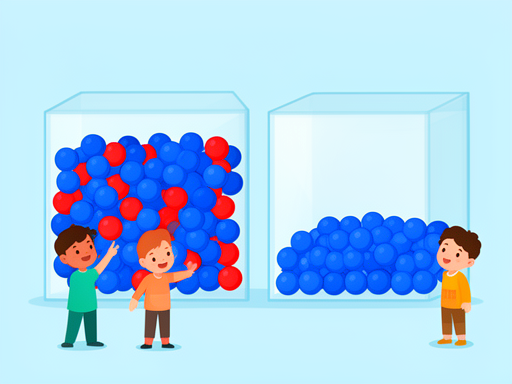
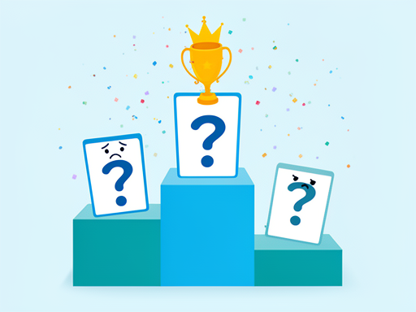
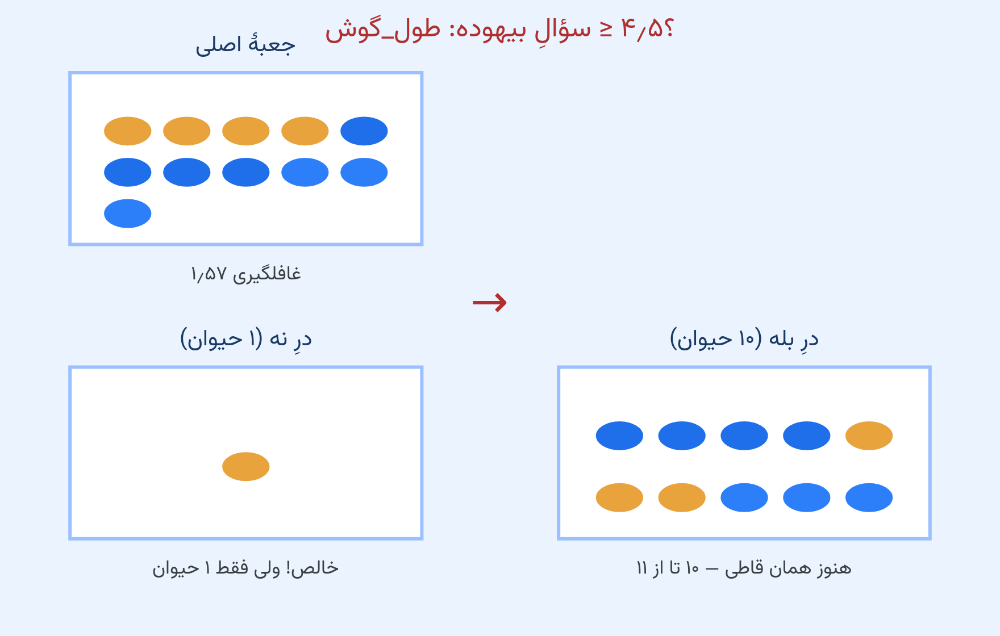
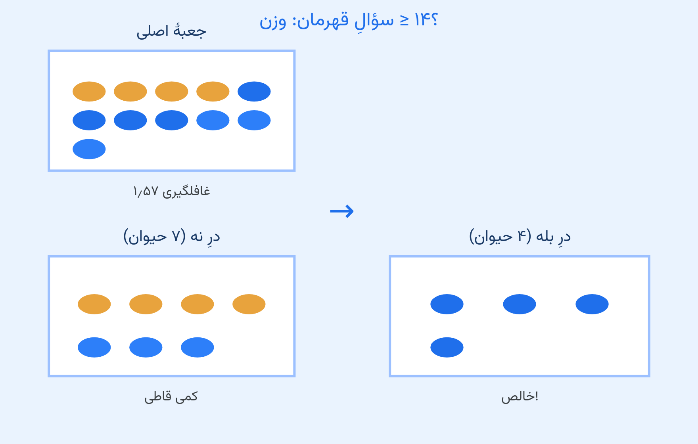
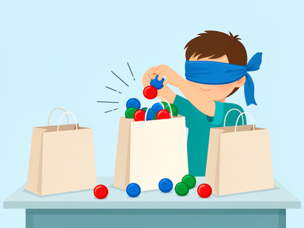
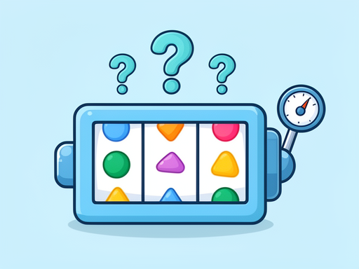
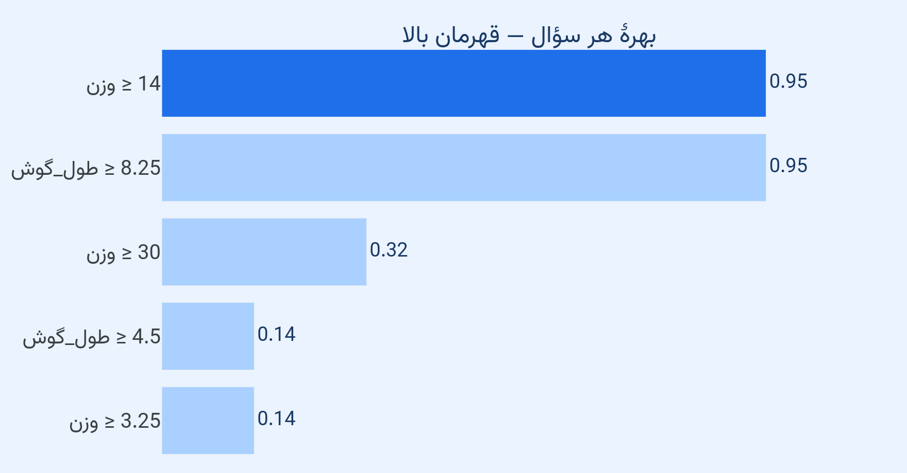
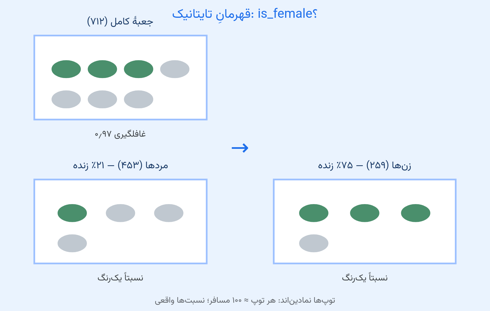
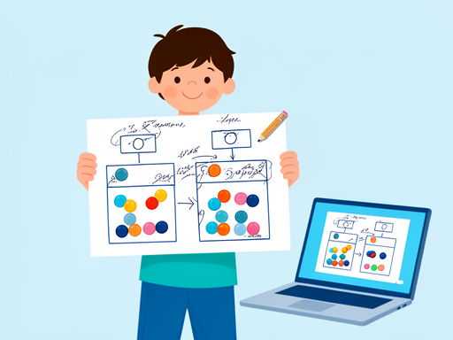
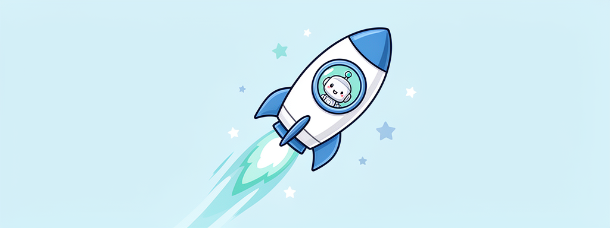

<!-- _class: lead -->
<!-- _paginate: false -->

# درخت چطور سؤالش را انتخاب می‌کند؟

## روز سوم — تو انتخاب‌کنندهٔ سؤال

**بخش ۱ · جلسهٔ ۳**

*امروز می‌فهمی کدام سؤال بهتر است — و چرا.*


<!--
INSTRUCTOR — Session 3 of 32. 60 min teaching + 60 min problem-solving.
BEFORE CLASS: PART 0 demo tested; three grab-bags prepared (8 blue; 4+4; 3+3+2); slides assets exist.
TIMING: hook 0-5, sortedness 5-15, surprise 15-25, the game 25-35, Titanic 35-45, you-be-the-machine 45-50, quiz 50-55, handout 55-60.
-->

---
<!-- _class: hook -->

# دو جعبه، یک سؤال

هدف: هر جعبه **یک‌رنگ** شود.

کدام جعبه کمک می‌خواهد؟ کدام تمام است؟



<!--
[0:00] HOOK beat 1 — two boxes on the board (or magnets).
Box A: 4 blue + 4 red mixed. Box B: 8 blue.
ASK: "Which box needs help?" — they answer instantly: A.
The word "sorted" arrives TODAY. Do not name it yet.
-->

---
<!-- _class: hook -->

# کدام سؤال بهتر مرتب می‌کند؟

جعبهٔ جدید: ۲ آبی + ۲ قرمز.

رأی: «قرمز است؟» یا «درشت است؟»

*رأی‌ها بمانند — ماشین همین بازی را می‌کند.*

<!--
HOOK beat 2 — the vote. Class votes on the TWO candidate questions on the slide.
"Is it red?" obviously wins — half the class wonders why we even asked.
Keep the votes on the board: the losing questions return on slide 6.
-->

---
<!-- _class: hook -->

# ماشین به سؤال‌هایش نمره می‌دهد

جلسهٔ ۲ ماشین `وزن ‎≥ ۱۴‎` را پرسید. **چرا ۱۴؟**

ببین: ماشین همهٔ سؤال‌ها را امتحان می‌کند و نمره می‌دهد.



<!--
[RUN: PART 0 demo cell] The leaderboard prints: every candidate question with its gain.
SAY: "It SHOPS for questions. It scores each one. The champion gets asked."
EXPECT: "It tried ALL the questions?!" — the S2 mystery is answered.
FALLBACK: narrate from the leaderboard slide (the committed picture in assets).
-->

---
<!-- _class: definition -->

# خلوص (Purity)

یعنی: جعبه چقدر **مرتب** است.

سؤالِ خوب: هر طرفِ در، **یک‌چیز** می‌ماند.

سؤالِ بیهوده: جعبه تکه می‌شود، شلوغی همان شلوغی.

<!--
[5:00] NAME slide — experience already happened (the votes).
[MISCONCEPTION] splitting evenly is NOT the goal — sorting is. A question can halve the box and sort nothing.
CHECK: "The elephant's side of our S2 tree — mixed or pure?" (pure — that's why the tree stopped asking.)
-->

---
<!-- _class: wow -->

# سؤالِ بیهوده



درِ نه **خالص** شد — ولی فقط ۱ حیوان! ده تایِ دیگر هنوز همان‌قدر قاطی‌اند.

<!--
SHOW the useless question: ear >= 4.5 splits off ONE cat (a pure but tiny side); the other 10 stay just as mixed.
POINT at the balls: "One side IS pure — but it holds only 1 of the 11. The score cares about the WHOLE box: big groups that get purer."
This slide teaches the weighted average WITHOUT the word — why a "perfectly pure" side can still earn nearly nothing (gain 0.14).
-->

---
<!-- _class: wow -->

# سؤالِ قهرمان



درِ بله: فقط سگ‌های بزرگ. **خالص!**

<!--
SHOW the champion: weight >= 14 — heavy side is PURE (4 big dogs).
TRACE: left side still has cats + small dogs mixed — a question for IT comes later (the light-box round).
SAY: "Same box, same two doors — but THIS question sorted. THAT difference is what the machine measures."
-->

---
<!-- _class: quiz -->

# مرتب شد یا نه؟

`وزن ‎≥ 30‎` ← نه: ۹ حیوان قاطی · بله: ۲ سگ بزرگ

*مرتب شد یا فقط تکه شد؟*

<!--
USE-IT (2 min): class votes on weight >= 30 before you comment.
Answer: PARTIALLY sorted — the yes-side is pure (2 big dogs), the no-side stays mixed.
So it is a real question, just not the champion — its gain is smaller (0.32 vs 0.95).
-->

---
<!-- _class: hook -->

# کیسه‌های غافلگیری

سه کیسه، یک توپِ بیرون‌کشیده‌شده به چشمِ بسته.

قبل از هر کشیدن، حدست را بگو. بعد: چندان غافلگیر شدی؟



<!--
[15:00] Segment B — the grab-bag game. 3 min, high energy.
Bag 1 (8 blue): no surprise. Bag 2 (4+4): coin-flip. Bag 3 (3+3+2): maximum.
Volunteer draws blind; class rates surprise 0-2 with fingers BEFORE each draw.
They just invented the ranking: pure = 0, mixed = big.
-->

---
<!-- _class: definition -->

# غافلگیری — آنتروپی (Entropy)

عددِ شلوغیِ جعبه:

- جعبهٔ خالص ← **۰**
- قاطی‌تر ← عدد بزرگ‌تر

*از شمردنِ رنگ‌ها می‌آید. فرمول لازم نیست.*



<!--
NAME slide. Write on board: the three bags get their numbers (0, 1, 1.56).
[MISCONCEPTION] entropy is NOT the machine thinking — it's a number from counting colors. The least magical part of the course.
[RUN: cell A2] machine prints the same ranking — check together.
-->

---
<!-- _class: quiz -->

# جعبهٔ ۱۱ حیوان: چند؟

۴ گربه، ۴ سگ بزرگ، ۳ سگ کوچک.

غافلگیری‌اش اول حدس بزن، بعد ببین.

<!--
USE-IT (cell A2b): class predicts "middle?" then runs.
Answer: 1.57 — almost the 3-color bag (same kind of mix: three things, none dominating).
-->

---
<!-- _class: definition -->

# بازی: تو امتیاز بده

روی تخته: هر سؤال → دو در → کی هر طرف می‌ایستد؟

تیمِ دونفره: «قاطیِ قبل منهای قاطیِ بعد» را برای هر سؤال حساب کن.

**قهرمان را فریاد بزن!**

<!--
[25:00] Segment C — THE game, EXPERIENCE first. No vocabulary yet.
The score card on the board: question | sides | surprise after | score.
Teams of two compute the 5 candidate questions (content.md Segment C). First correct champion shouts.
Watch for the TIE: weight ≥ 14 and ear ≥ 8.25 both score 0.95 — let a team notice it themselves.
-->

---
<!-- _class: definition -->

# نمرهٔ سؤال: بهرهٔ اطلاعاتی (Information Gain)

**بهره = غافلگیریِ قبل − غافلگیریِ بعد**

سؤالِ قهرمان: بیشترین بهره.

<!--
NAME slide — what the teams just computed BY HAND has a name: information gain.
[MISCONCEPTION] the champion is NOT the purest side — it is the biggest surprise-drop for the WHOLE box
(the bad question's one-animal pure side won almost nothing).
-->

---
<!-- _class: wow -->

# جدول امتیازها



قهرمان‌ها مساوی‌اند: `وزن ‎≥ ۱۴‎` و `طول_گوش ‎≥ ۸٫۲۵‎`.

<!--
[RUN: cell A3] the machine's leaderboard — same ranking the class computed.
THE TIE: both champions gain 0.95. The machine breaks ties by column order (weight first) — boring, honest.
SAY: "It plays this game on EVERY node — millions of times per tree."
-->

---
<!-- _class: quiz -->

# راند دوم: جعبهٔ سبک

۷ حیوان: ۴ گربه + ۳ سگ کوچک. غافلگیری: ۰٫۹۹

قهرمانِ این جعبه کدام است؟

<!--
USE-IT (cell A3b): class predicts BEFORE running.
Answer: ear >= 8.25 — takes the box to ZERO surprise (both sides pure).
SAY: "You just derived the S2 tree's second question yourselves."
-->

---
<!-- _class: hook -->

# ماشین این بازی را روی تایتانیک هم می‌کند

۷۱۲ مسافر. جعبهٔ قاطی: ۲۸۸ زنده، ۴۲۴ نزنده.

*همان دادهٔ جلسهٔ ۱ — این بار با نمره.*

<!--
[35:00] Segment D — THE MOMENT. Students code along cells A4-A5.
A4: the Titanic box, surprise 0.97.
ASK: "Is this box sorted? What's our surprise?"
-->

---
<!-- _class: wow -->

# قهرمانِ تایتانیک



`is_female` — بهرهٔ ۰٫۲۱؛ نزدیک به سه برابرِ نفرِ دوم (۰٫۰۸).

<!--
[RUN: cell A5] the leaderboard: is_female 0.214 > pclass 0.083 > fare 0.069 > age 0.018.
CALLBACK: "Session 1, you voted gender matters most. You beat the machine to it — it just put a NUMBER on your vote."
[MISCONCEPTION] gain measures sorting, not CAUSES. One sentence only (Session 9 opens the fairness door properly).
-->

---
<!-- _class: codespot wow -->

# کلِ راز

```python
for every possible question:
    score = surprise_before - surprise_after
champion = the biggest score
```

*خطِ چهارمی وجود ندارد.*

<!--
[45:00] Segment E — you be the machine.
[RUN: cell A6] the loop in plain Python — best_question() on the full box, then on the light box.
REBUILD the S2 tree on the board AS A CLASS: root champion -> light box -> second champion.
HONEST BEAT: the machine doesn't think — it measures and takes the max, like a scale. Ties broken by column order.
-->

---
<!-- _class: dark -->

# انتخابِ سؤال، کارِ ماست

ماشین فقط میانِ ستون‌های جدول می‌گردد.

«آیا هاپ می‌زند؟» هیچ‌وقت پرسیده نمی‌شود — چون ستون نیست.

<!--
The C2 rabbit returns: no depth, no examples could fix it — the FIX was a new feature.
Feature choice is OUR job; scoring is the machine's. (Seed of Session 7 — one sentence, then stop.)
-->

---
<!-- _class: quiz -->


# امروز یاد گرفتی

- **خلوص** = یک‌رنگیِ جعبه
- **آنتروپی** = عددِ غافلگیری
- **بهره** = قبل − بعد؛ قهرمان = بیشترین بهره
- قهرمانِ تایتانیک: `is_female` — رأیِ جلسهٔ ۱

<!--
[50:00] CONSOLIDATION — cold call, one question per student:
what does a good question do? what is entropy in kid words? how is a question scored?
why weight >= 14? what won on Titanic?
If anyone stumbles on Q1-3, re-explain NOW.
-->

---
<!-- _class: handout -->

# تحویل امشب + تمرین‌های خانه (۳ تا)

1. **B1** غافلگیریِ سه کیسه  2. **B2** قهرمانِ جعبهٔ سبک  3. **B3** قهرمانِ تایتانیک + نقشهٔ کشتی

«رأیِ جلسهٔ ۱‌ام، امروز عدد شد.» — **سیُمین Ship ات**



<!--
[55:00] THE SHIP + handout in one. The annotated split plot IS the Ship (cell B3) — YOUR hand-analyzed Titanic map.
One sentence of story per problem:
B1 compute the bags' surprise numbers; B2 derive the light box champion; B3 the Titanic leaderboard + the annotated plot.
~20-30 min; deadline before the problem-solving session; next session solves them TOGETHER from their attempts.
Judge is instructor-only: python judge/run.py s03_notebook.ipynb
-->

---

<!-- _class: lead -->
<!-- _paginate: false -->

# جلسهٔ بعد

ماشین سؤال‌هایش را روی مسافرهایی که **دیده** امتحان می‌کند...

و اگر فقط همین‌ها را حفظ کرده باشد؟

دفعهٔ بعد: آزمونِ سختِ تقلب.



<!--
[60:00 — end on time.] CLIFFHANGER verbatim:
"What if a question is only 'good' on the animals it has SEEN?
Tomorrow: a student who memorized every exam answer — and how to catch a machine fooling itself."
NEXT SESSION: train vs test (S4).
AFTER CLASS (48h): fill the retro note in the session README.
-->
